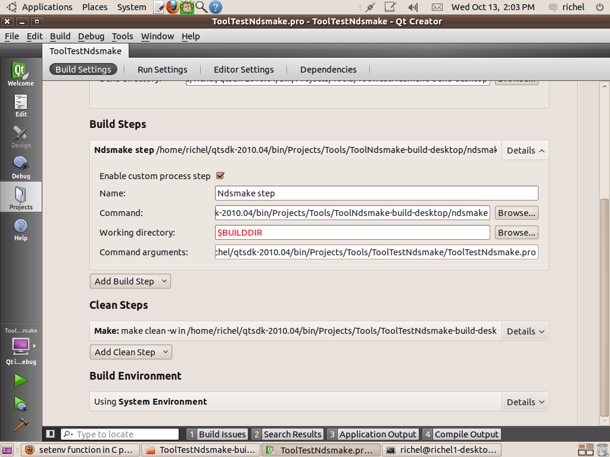

# ndsmake

Generate [Makefiles](https://github.com/richelbilderbeek/cpp/blob/master/content/CppMakefile.md) for [NDS](https://github.com/richelbilderbeek/cpp/blob/master/content/CppNds.md).

ndsmake is one of [Richèl Bilderbeek's tools](https://richelbilderbeek.github.io/tools/).

## Links

- [Source code](https://github.com/richelbilderbeek/ndsmake)
- [Richèl Bilderbeek's tools](https://richelbilderbeek.github.io/tools/)
